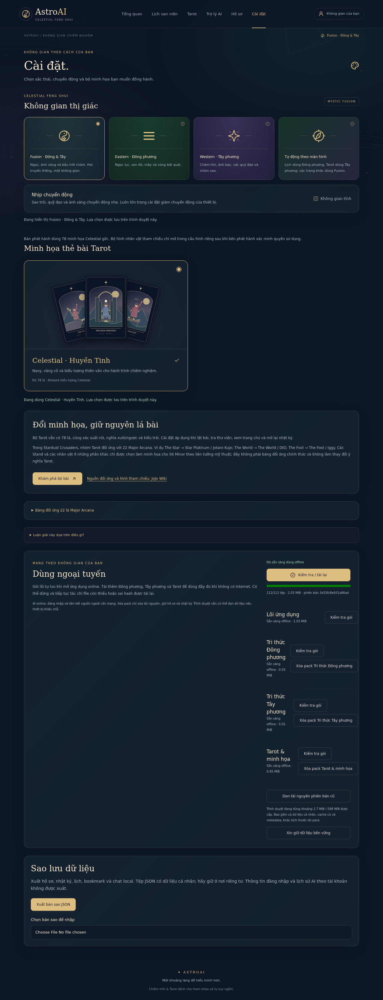

# Kiểm chứng AstroAI 2.0 — 31/10/2026

Base `a843eb1`. Thay đổi được chuẩn bị thành một commit để push trực tiếp `master` theo yêu cầu chủ dự án. Báo cáo mô tả source và kiểm thử, không xác nhận backend đã deploy hoặc khóa lịch sử đã thu hồi.

## Kết quả đã chạy

| Kiểm tra | Kết quả |
| --- | --- |
| `npm run typecheck` | Pass |
| `npm test` | **45 tests pass**: core 11, Tarot 7, AI handler 6, local chat 5, backup 4, service worker 6, IndexedDB 4, solar/snapshot 2 |
| Local corpus | 128 câu mẫu độc lập và câu chuẩn cho cả 229 nhóm tra cứu đều đúng intent |
| `npm run build` | Pass, kèm kiểm chứng 4 pack, SHA-256, sizes, ownership, icons và gate dung lượng |
| Browser E2E | **13 pass**, 2 test JoJo opt-in được bỏ qua ở cấu hình phát hành chuẩn |
| Production offline E2E | **4 pass** |
| Responsive | 7 route ở 320, 375, 390, 768, 1280 px; ba theme ở 360 px; không overflow |
| Motion/keyboard | OS reduced-motion, không gian tĩnh, modal Escape, swipe lịch không click nhầm ngày |
| `git diff --check` | Pass |

Chromium kiểm thử cục bộ: 141.0.7390.0, chạy qua Playwright 1.64.1. Binary là công cụ kiểm thử ngoài repository, không đóng vào ứng dụng. CI dùng browser do Playwright cài trên runner.

## Hành vi đã xác nhận

- Tải đủ tài nguyên, ngắt mạng, đóng tab và mở tab mới; lịch, tra cứu, 78 hình, luận giải và nhật ký vẫn dùng được.
- Hỏi 10 câu local và một câu ngoài phạm vi khi offline; nguồn được phân biệt, không giả lập hội thoại AI.
- File hỏng/503 không báo ready; thử lại chỉ hoàn thiện phần thiếu. Hủy giữ phần đã tải; từng pack có trạng thái riêng và có thể xóa/tải lại.
- Xóa pack Đông phương không xóa hồ sơ IndexedDB; nội dung chưa tải được thông báo; trở lại online có thể tải lại.
- Cache-only reads khi browser báo offline không âm thầm tải lại pack vừa xóa.
- IndexedDB chuyển dữ liệu LocalStorage cũ, chụp snapshot trước chuyển; không nhập Supabase auth token. Ghi được khi LocalStorage bị chặn; transaction import bị lỗi không ghi dở.
- Backup JSON có preview, giữ ID/cài đặt hiện có, giới hạn 8 MiB và allowlist. Không xuất token hay lịch sử AI theo tài khoản.
- Snapshot Tarot giữ nguyên luận giải qua cập nhật nội dung; dữ liệu snapshot hỏng bị từ chối.
- SW chờ người dùng chấp nhận, kiểm đủ bản mới trước activation và giữ cache cho tab cũ. Dọn cache cũ từ chối khi còn tab khác.

## Dung lượng đo từ build

Manifest `3d33fc8e501a66ad`; tổng gồm worker/manifest:

| Chỉ số | MiB |
| --- | ---: |
| Raw assets | 2.081 |
| Ước tính gzip transfer | 0.517 |
| Core raw | 1.033 |
| Giới hạn raw và gzip estimate | 50 |

| Pack | Files | Raw MiB |
| --- | ---: | ---: |
| core | 29 | 1.033 |
| eastern | 1 | 0.033 |
| western | 1 | 0.009 |
| tarot | 81 | 0.953 |

SVG được nén rất hiệu quả; gzip là ước tính từ file build, không phải số traffic đã đo trên hosting. Không cộng dữ liệu cá nhân, metadata của browser hoặc cache phiên bản trước. `reports/offline-size.json` là báo cáo từng file do build/CI tạo.

## Nguồn và giới hạn

Bộ Celestial chuẩn gồm 78 cảnh SVG gốc, có source tái tạo. Bộ ảnh nhân vật JoJo chỉ còn ở cấu hình opt-in, không xuất trong build chuẩn khi chưa xác minh quyền phát hành. Nghĩa Tarot không đổi khi chọn bộ hình.

Lịch Việt Nam dùng UTC+7. Trực theo tháng tiết khí ở 12:00 UTC+7; mô hình Mặt Trời và bốn trụ là xấp xỉ, đổi ngày lúc 00:00. Năm Bát tự theo Lập Xuân có thể khác năm âm theo Tết. Cung Mặt Trời dùng khoảng ngày; chưa có Moon/Rising/natal chart ephemeris.

Không tiếp tục dùng công thức 28 Tú reset theo tháng âm: mục này hiển thị “Chưa kiểm định” và không tham gia điểm ngày, cho đến khi có mốc chu kỳ được đối chiếu. Không cam kết mọi trường phái cho cùng kết quả.

Còn cần thao tác/tài nguyên bên ngoài: thu hồi khóa lịch sử và kiểm tra usage nhà cung cấp; deploy/kiểm chứng Supabase RLS bằng tài khoản thật; thử iPhone/Android/PWA thật, Lighthouse/Web Vitals/FPS trên thiết bị. CI và Chromium desktop không thay thế các bước đó. Cloud sync/conflict và natal chart đầy đủ là sau MVP.

## Minh họa và rollback

Rollback bằng revert commit và deploy lại toàn bộ dist, giữ IndexedDB/LocalStorage. Không chỉ định clear browser data. Các bản ghi cũ vẫn tương thích; snapshot luận giải là trường bổ sung tùy chọn. Chỉ dùng nút xóa pack để dọn asset, và nút dọn phiên bản cũ khi đã đóng tab khác.
